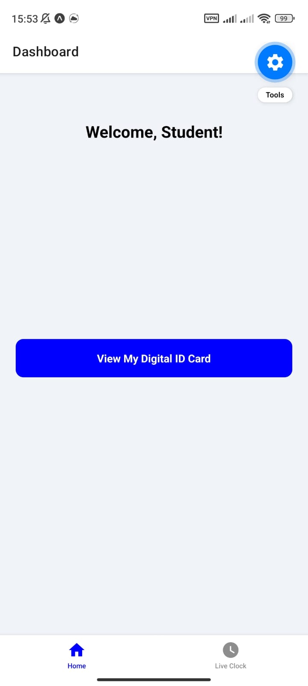
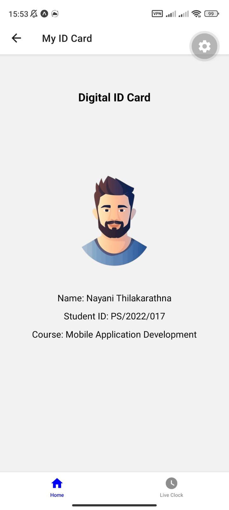
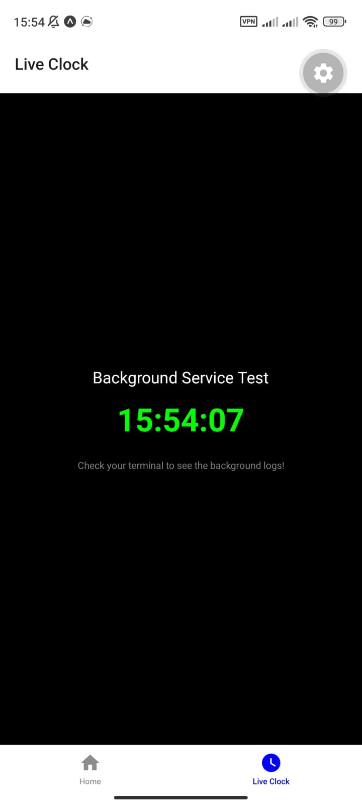
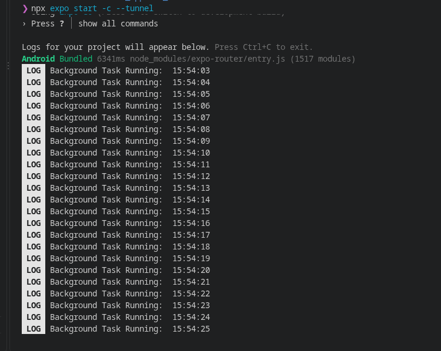

# StudentHub

Mobile Application Development - Practical 03

In this lab we built a simple student hub app using Expo, React Native and Expo Router in VS Code.

## What we built

- **Bottom tabs** - two tabs at the bottom of the screen, Home and Live Clock (`app/_layout.tsx`).
- **Dashboard** - the Home tab shows a welcome message and a button to open the ID card. The Home tab uses a stack navigator (`app/(home)/_layout.tsx`).
- **My ID Card** - shows a digital student ID card with a photo, name, student ID and course.
- **Live Clock** - shows the current time and updates it every second using `setInterval`. It also prints a log in the terminal every second.

## How to run

```bash
npm install
npx expo start -c
```

Then scan the QR code with the Expo Go app.

## Output screens

| Dashboard | My ID Card | Live Clock |
|:---:|:---:|:---:|
|  |  |  |

### Terminal logs


